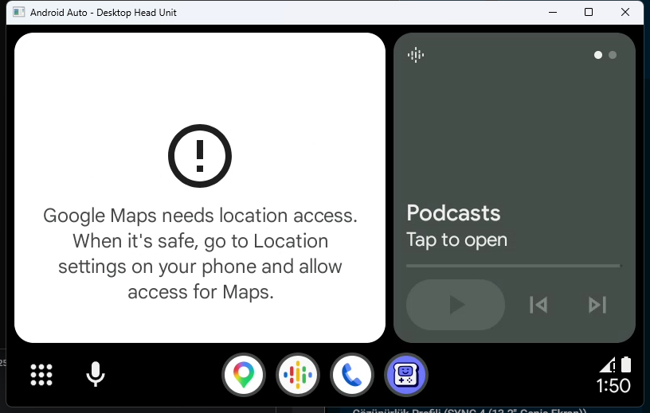
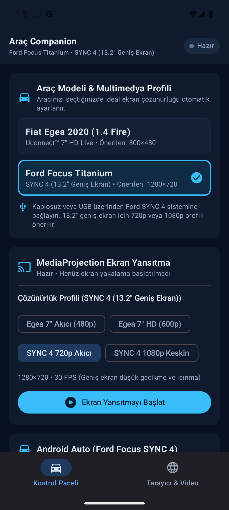
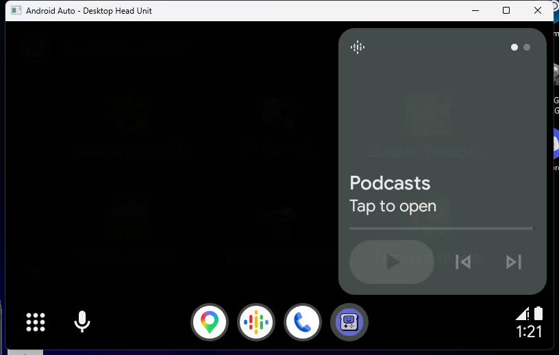
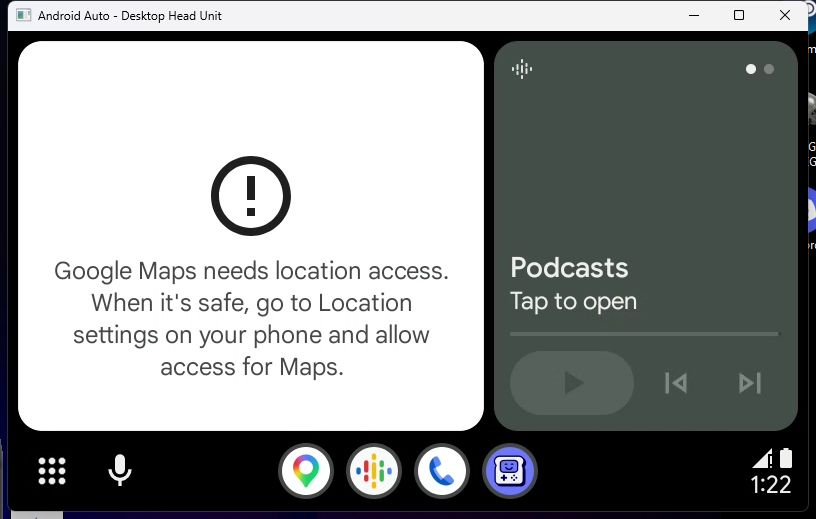
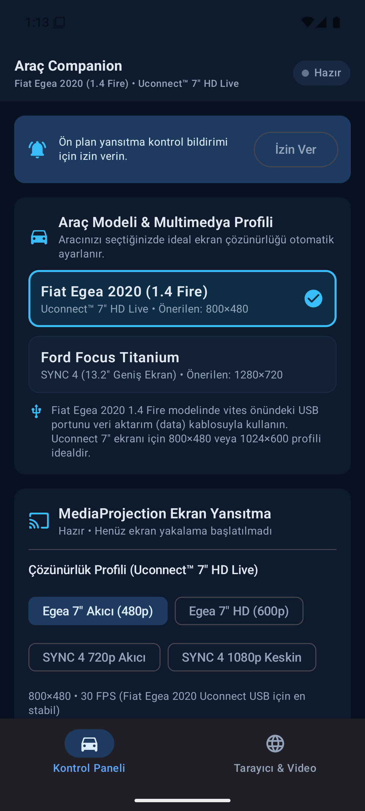

# 🚗 Araç Companion — Sync4 & Fiat Egea Uconnect Canlı Video ve Ekran Yansıtma

**Fiat Egea 2020 (1.4 Fire — Uconnect™ 7" HD Live)** ve **Ford Focus (SYNC 4 — 13.2" Geniş Ekran)** multimedya sistemleri için geliştirilmiş; telefondan açılan **YouTube / HTML5 videolarını ve web sayfalarını doğrudan araç ekranında (Android Auto `Surface`) canlı olarak oynatan** yardımcı uygulama, ekran yansıtma (`MediaProjection` + `PixelCopy`) motoru ve tam ekran HTML5 Web Tarayıcısı.

---

## 📸 Ekran Görüntüleri ve Çalışma Akışı

### 1. Canlı YouTube Video Oynatma (Araç Ekranı & Telefon Eşzamanlı)

| Araç Ekranında Canlı YouTube Videosu (DHU / Uconnect / SYNC 4) | Telefon Ekranında Tarayıcı & Video Sekmesi |
| :---: | :---: |
|  |  |

---

### 2. Araç Ekranı (Android Auto) Adım Adım Kullanım

| 1. Uygulama Listesinde `Araç Companion` | 2. Araç Kontrol Paneli (`PaneTemplate`) | 3. Hızlı Web & Video Kısayolları (`ListTemplate`) |
| :---: | :---: | :---: |
|  |  |  |

---

### 3. Telefon Kontrol Paneli (Araç Profili ve Çözünürlük Seçimi)

<p align="center">
  
</p>

---

## ✨ Temel Özellikler

- **🎬 Araç Ekranında Canlı YouTube & HTML5 Video Oynatma (`CarSurfaceRenderer` + `CompanionVideoMirrorScreen`):**
  - Android Auto `SurfaceCallback` ve `NavigationTemplate` üzerinden araç ekranının donanım `Surface` (`SurfaceContainer`) yüzeyini doğrudan devralır.
  - Standart `WebView.draw(Canvas)` donanım hızlandırmalı HTML5 `<video>` katmanını siyah bıraktığı için, **`PixelCopy.request(window, ...)`** kullanarak telefonun GPU kompozitör tamponundan oynayan YouTube video karelerini ~22 FPS hızında yakalar ve 16:9 araç ekranına odaklayarak canlı çizer.
  - Araç ekranının üst barındaki **`Oynat / Duraklat`**, **`Web Kısayolları`** ve **`Kontrol Paneli`** butonlarıyla veya doğrudan araç ekranı yüzeyine dokunarak (`onClick`, `onScroll`) telefondaki videoyu kontrol etme imkanı sunar.
- **🚘 Çoklu Araç Multimedya Profili Desteği:**
  - **Fiat Egea 2020 (1.4 Fire):** Uconnect™ 7" HD Live ekranı için optimize edilmiş `800×480 (160 DPI)` ve `1024×600 (200 DPI)` 30 FPS profilleri.
  - **Ford Focus Titanium (SYNC 4):** 13.2" geniş ekran için `1280×720 (240 DPI)` ve `1920×1080 (320 DPI)` profilleri.
- **📡 Çift Katmanlı Yakalama Mimarisi (`PixelCopy` + `MediaProjection`):**
  - **Anında Akış (İzin Beklemeden):** `Tarayıcı & Video` sekmesinde açılan YouTube veya web videosu, `PixelCopy` ile anında araç ekranına aktarılır.
  - **Tam Sistem Ekranı Yansıtma (`ScreenMirrorService`):** Android 14/15/16+ (`FOREGROUND_SERVICE_MEDIA_PROJECTION`) uyumlu ön plan servisi ile `VirtualDisplay` + `ImageReader` üzerinden yakalanan kareler `CarSurfaceRenderer.onMediaProjectionImage(image)` ile doğrudan araç yüzeyine çizilir.
- **🌐 Dahili HTML5 Web & Video Tarayıcı:**
  - YouTube, TRT tabii ve canlı yayınlar için tam ekran (`Immersive Sticky`) video oynatma, otomatik video başlatma, masaüstü/mobil kullanıcı aracısı (`User-Agent`) geçişi ve SPA geri/ileri geçmiş yönetimi.

---

## 🏗️ Mimari Yapı

```text
app/src/main/java/com/sync4/carcompanion/
├── MainActivity.kt                  # Jetpack Compose Kontrol Paneli + HTML5 WebView Video Tarayıcı
├── car/
│   ├── CompanionCarAppService.kt    # Android Auto CarAppService giriş noktası (ALLOW_ALL_HOSTS_VALIDATOR)
│   ├── CompanionCarSession.kt       # Araç oturumu yaşam döngüsü ve SurfaceCallback kaydı
│   ├── CompanionMainScreen.kt       # Araç kontrol paneli şablonu (PaneTemplate)
│   ├── CompanionBookmarksScreen.kt  # Hızlı web/video kısayolları (ListTemplate -> VideoMirrorScreen)
│   ├── CompanionVehicleScreen.kt    # Araç modeli seçim ekranı (Fiat Egea 2020 / Ford SYNC 4)
│   └── CompanionVideoMirrorScreen.kt# Araç ekranında tam ekran canlı video oynatma şablonu (NavigationTemplate)
├── mirror/
│   ├── CarSurfaceRenderer.kt        # PixelCopy + MediaProjection karelerini araç Surface yüzeyine çizen motor
│   └── ScreenMirrorService.kt       # Ön plan MediaProjection + VirtualDisplay + ImageReader servisi
└── state/
    └── CompanionStateRepository.kt  # Telefon, servis ve araç ekranı arasındaki reaktif StateFlow köprüsü
```

---

## 📲 Telefona APK Kurulumu ve Araç Bağlantısı

1. **APK Kurulumu:**
   - Projeyi derleyerek `app/build/outputs/apk/release/app-release.apk` dosyasını telefonunuza yükleyin (WhatsApp veya dosya yöneticisi üzerinden doğrudan kurulabilir).
2. **Android Auto Geliştirici Ayarları (Bilinmeyen Kaynaklar İzni):**
   - APK Play Store dışından (sideload) yüklendiği için telefonunuzda bir defaya mahsus şu adımı uygulayın:
     1. Telefonunuzda **Ayarlar > Bağlı Cihazlar > Bağlantı Tercihleri > Android Auto** ekranını açın.
     2. En alttaki **Sürüm (Version)** satırına art arda **10 kez** dokunarak **Geliştirici Modunu** etkinleştirin.
     3. Sağ üstteki **üç nokta (⋮) > Geliştirici ayarları (Developer settings)** menüsüne girin.
     4. En aşağı inip **Bilinmeyen kaynaklar (Unknown sources)** kutucuğunu işaretleyin ve **Uygulama modu**'nu **Geliştirici (Developer)** seçin.
3. **Araçta Video Oynatma:**
   - Telefonunuzu veri aktarım (data) kablosuyla **Fiat Egea 2020 (1.4 Fire)** vites önündeki USB portuna veya kablosuz/USB ile **Ford SYNC 4** sistemine bağlayın.
   - Araç ekranındaki uygulama listesinden **`Araç Companion`** simgesine dokunun.
   - **`Web Kısayolları` > `YouTube Video Test (Big Buck Bunny)`** (veya **`YouTube Web`**) seçeneğine dokunduğunuzda video hem telefonunuzda hem de araç ekranında canlı olarak oynatılır.

---

## 🧪 Derleme ve Testler

Projede **78 adet** kapsamlı birim, şablon, servis ve Compose UI testi bulunmaktadır:

```powershell
# Tüm birim ve Android Auto şablon testlerini çalıştırma
.\gradlew.bat :app:testDebugUnitTest

# Debug ve imzalı Release APK paketlerini derleme
.\gradlew.bat :app:assembleDebug :app:assembleRelease
```

---

## 🛠️ Teknoloji Yığını

- **Dil & UI:** Kotlin, Jetpack Compose, Material 3
- **Derleme & SDK:** AGP 9.x, `compileSdk 37` / `targetSdk 37`, `minSdk 29`
- **Araç Entegrasyonu:** Jetpack Car App Library (`androidx.car.app:app` & `app-projected` `1.7.0`)
- **Video & Yansıtma:** `SurfaceCallback`, `NavigationTemplate`, `PixelCopy` (GPU pencere yakalama), `MediaProjection`, `VirtualDisplay`, `ImageReader`
- **Test Altyapısı:** JUnit 4, Robolectric, `androidx.car.app:app-testing`, Compose UI Test
